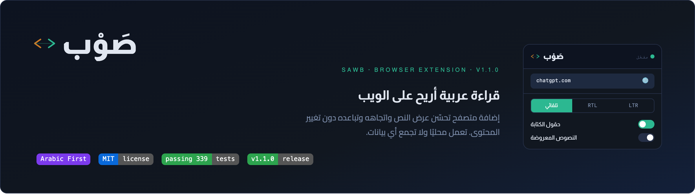
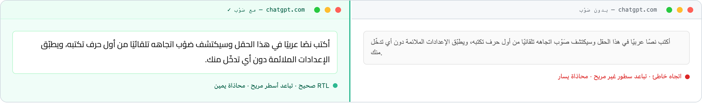
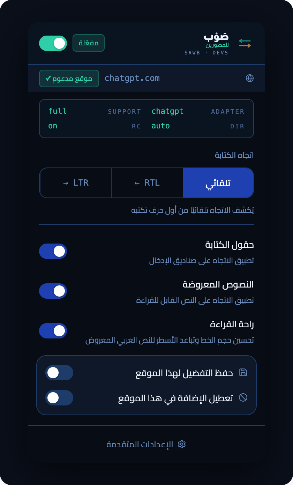
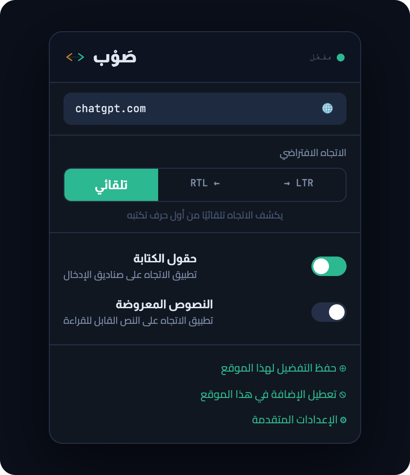

<div dir="rtl" align="center">

# صَوْب · SAWB

**قراءة عربية أريح على الويب**

إضافة لمتصفحات Chromium تضبط اتجاه الكتابة بين RTL وLTR تلقائيًا، وتحسّن عرض النص العربي دون تغيير محتواه. تعمل محليًا بالكامل، بلا حساب ولا خادم.



</div>

<div dir="rtl">

## قبل / بعد



## المزايا

- **اتجاه تلقائي أو يدوي:** تحدّد صَوْب الاتجاه من أول حرف له اتجاه، متجاوزةً الروابط والأرقام والإصدارات وأسماء الملفات في بداية النص، أو تفرض RTL/LTR يدويًا.
- **حقول الكتابة والنصوص المعروضة:** لكلٍّ منهما مفتاح مستقل، على مستوى الإضافة أو لكل موقع.
- **راحة القراءة:** تكبير الخط (100–130%) وتباعد الأسطر (1.4–2.2) للكتل العربية المعروضة فقط، دون المساس بحقول الكتابة أو النص الإنجليزي. مطفأة افتراضيًا.
- **حماية المحتوى التقني:** كتل الشيفرة والصيغ الرياضية (KaTeX) ومحررات CodeMirror وMonaco لا تُمسّ، والعناصر التقنية داخل الفقرة العربية تبقى LTR.
- **احترام تصميم الموقع:** تسجّل صَوْب ملكية كل خاصية CSS تطبّقها، ولا تكتب فوق تعديلات يجريها الموقع بعدها.
- **استعادة آمنة:** عند التعطيل تعود الصفحة إلى حالتها الأصلية، ولا يتغيّر محتوى النص في أي حال.
- **تفضيلات لكل موقع:** حفظ الاتجاه والإعدادات لموقع بعينه، أو تعطيل الإضافة فيه، وإدارة المواقع المحفوظة من صفحة الإعدادات.
- **مؤشر الاتجاه:** علامة صغيرة بجانب حقل الكتابة النشط، يمكن إخفاؤها.
- **مظهر فاتح وداكن وتلقائي** للنافذة المنبثقة وصفحة الإعدادات.

### اختصارات لوحة المفاتيح

| الاختصار | الوظيفة |
|---|---|
| <kbd>Alt</kbd>+<kbd>Shift</kbd>+<kbd>R</kbd> | الاتجاه RTL |
| <kbd>Alt</kbd>+<kbd>Shift</kbd>+<kbd>L</kbd> | الاتجاه LTR |
| <kbd>Alt</kbd>+<kbd>Shift</kbd>+<kbd>A</kbd> | الوضع التلقائي |
| <kbd>Alt</kbd>+<kbd>Shift</kbd>+<kbd>D</kbd> | تعطيل الإضافة مؤقتًا أو إعادة تفعيلها |

تسري الاختصارات على التبويب الحالي مؤقتًا دون تغيير التفضيل المحفوظ، ويمكن تغييرها من `chrome://extensions/shortcuts`.

## المواقع المدعومة

| الموقع | حقول الكتابة | النصوص المعروضة |
|---|:---:|:---:|
| ChatGPT | ✓ | ✓ |
| Claude | ✓ | ✓ |
| Gemini | ✓ | ✓ |
| Google AI Studio | ✓ | ✓ |
| GitHub | ✓ | ✓ |
| Substack | ✓ | ✓ |

«النصوص المعروضة» مطفأة افتراضيًا، وتفعيلها من الإعدادات العامة يشمل المواقع المدعومة. أي موقع آخر يعمل بوضع عام آمن يقتصر على حقول الكتابة، ما لم تفعّل النصوص المعروضة لذلك الموقع من النافذة المنبثقة.

## صَوْب للمطورين

وضع اختياري يُفعَّل من الإعدادات، ويضيف إلى النافذة المنبثقة شريط تشخيص يعرض المحوّل النشط (ADAPTER) ومستوى الدعم (SUPPORT) والاتجاه المطبّق (DIR) وحالة راحة القراءة (RC). يغيّر شكل الواجهة فقط، ولا يغيّر معالجة الصفحات.

<div align="center">

</div>

## كيف تعمل؟


تحلّل صَوْب العناصر النصية القابلة للقراءة، وتطبّق عليها الاتجاه وخصائص العرض مع تسجيل ما تملكه. عند التعطيل تزيل ما زالت تملكه فقط، فتبقى تعديلات الموقع اللاحقة كما هي.

## المتطلبات

- متصفح مبني على Chromium يدعم Manifest V3: Chrome (مختبر)، وEdge وBrave وArc (متوافقة مبدئيًا ضمن Chromium).
- Firefox وSafari غير مدعومين حاليًا.

## التثبيت

الإصدار الرسمي الحالي هو **v2.0.0**، وكل الإصدارات تُنشر في [صفحة الإصدارات](https://github.com/iSltanX/SAWB/releases) على GitHub.

1. نزّل ملف `sawb-chromium-vX.Y.Z.zip` المرفق بأحدث إصدار، وفُك ضغطه.
2. افتح `chrome://extensions` (أو ما يقابلها في متصفحك) وفعّل **وضع المطوّر** (Developer mode).
3. اختر **Load unpacked** وحدّد المجلد الذي يحتوي `manifest.json`.

<div align="center">

</div>

بعد التثبيت: اضغط أيقونة صَوْب في شريط الأدوات، واختر الاتجاه أو اتركه تلقائيًا. «راحة القراءة» تُفعَّل من النافذة نفسها ولا تُطبَّق إلا مع «النصوص المعروضة»، وتُضبط قيمتا حجم الخط وتباعد الأسطر من صفحة الإعدادات («الإعدادات المتقدمة»).

## البناء من المصدر

يتطلب Node.js 20 أو أحدث.

</div>

```bash
git clone https://github.com/iSltanX/SAWB.git
cd SAWB
npm ci

npm run check     # typecheck + lint + test + build
npm run build     # dist/ (حمّله عبر Load unpacked)
npm run package   # dist-packages/sawb-chromium-v<version>.zip
```

<div dir="rtl">

بنية المشروع:

</div>

```text
src/
  adapters/    محوّلات المواقع المدعومة والوضع العام
  background/  عامل الخدمة واختصارات لوحة المفاتيح
  config/      روابط المستودع
  content/     سكربت المحتوى ومؤشر الاتجاه
  core/        كشف الاتجاه والتصنيف والتطبيق والمراقبة
  platform/    التخزين والرسائل والأنواع
  ui/          النافذة المنبثقة وصفحة الإعدادات والخطوط
tests/         اختبارات Vitest
manifest/      ملف Manifest V3
scripts/       البناء والتحزيم وتوليد الأيقونات والخطوط
```

<div dir="rtl">

ملاحظات صيانة محوّل Claude وطريقة إعادة التحقق منه بعد تغيّر واجهة الموقع في [docs/CLAUDE-DOM-INSPECTION.md](docs/CLAUDE-DOM-INSPECTION.md)، وقرارات هوية «صَوْب للمطورين» في [docs/sawb-dev-identity.md](docs/sawb-dev-identity.md).

## الخصوصية والأذونات

صَوْب لا تجمع بيانات، ولا تستخدم تحليلات، ولا تتصل بأي خادم. الإعدادات تُحفظ في `storage.local` داخل متصفحك فقط.

- **`storage`:** لحفظ الإعدادات وتفضيلات المواقع محليًا.
- **سكربت محتوى على كل المواقع** (`<all_urls>`، بما فيها الإطارات الداخلية): ليعمل ضبط الاتجاه في أي موقع. يقرأ النص محليًا لتحديد اتجاهه فقط، ولا يرسله إلى أي جهة.

لا تطلب الإضافة أذونات `tabs` أو `activeTab` أو `scripting`.

## القيود الحالية

- نطاقات Substack المخصصة لا تُميَّز كمواقع Substack، وتعمل بالوضع العام.
- محررات CodeMirror تُترك بلا تدخل عمدًا.
- مؤشر الاتجاه داخل الصفحات يستخدم خط النظام العربي؛ الخطوط المضمّنة في واجهات الإضافة فقط.
- «راحة القراءة» تتطلب تفعيل «النصوص المعروضة»؛ مع إيقافها يبقى التفضيل محفوظًا دون تطبيق.
- وضع المطورين يعرض شريط تشخيص موجزًا، ولا يتضمن لوحة فحص تفصيلية للعناصر.

## الرخصة

مرخّص برخصة [MIT](LICENSE). خطّا Cairo وAlmarai (SIL OFL 1.1) وأشكال أيقونات lucide (ISC) المضمّنة موثّقة في [THIRD_PARTY_NOTICES.md](THIRD_PARTY_NOTICES.md). سجل التغييرات في [CHANGELOG.md](CHANGELOG.md).

</div>

---

<p align="center">
  <picture>
    <source media="(prefers-color-scheme: dark)" srcset="docs/assets/brand/sultan_calligraphy-dark.svg">
    
  </picture>
</p>

<p align="center" dir="rtl"><b>تصميم وبرمجة سلطان</b><br>By Sultan · <a href="https://github.com/iSltanX">github.com/iSltanX</a><br>للتواصل: <a href="mailto:S@BySltan.com">S@BySltan.com</a></p>
